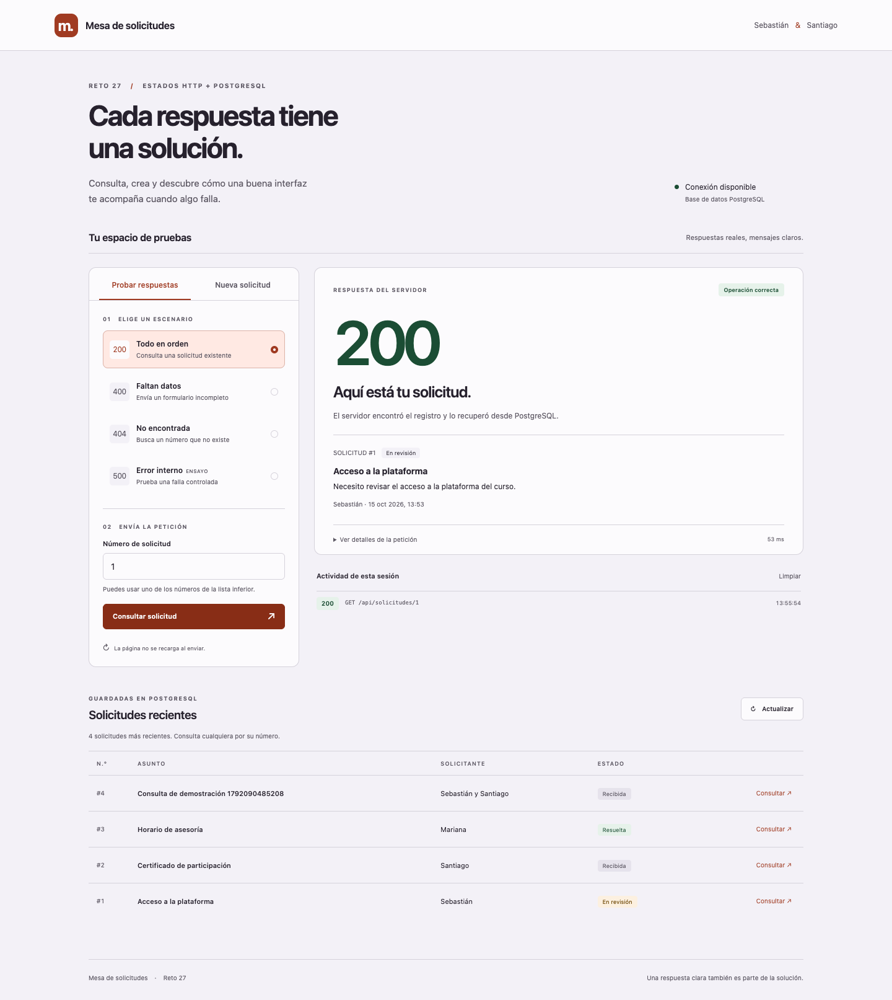
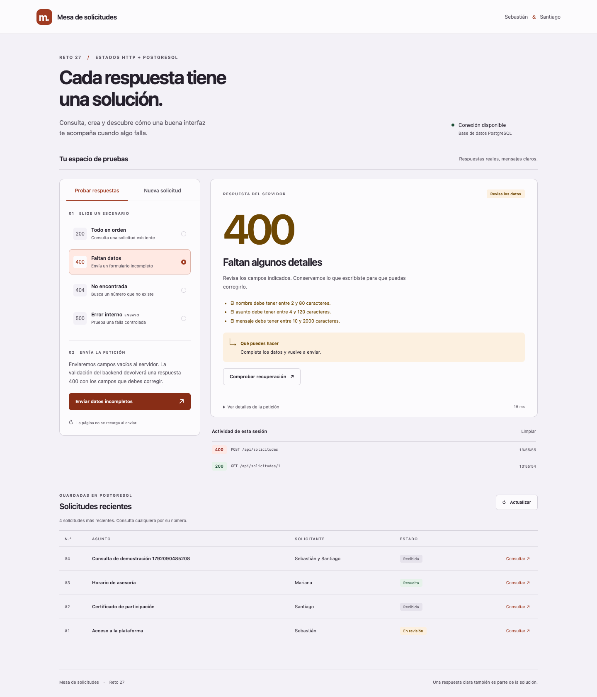
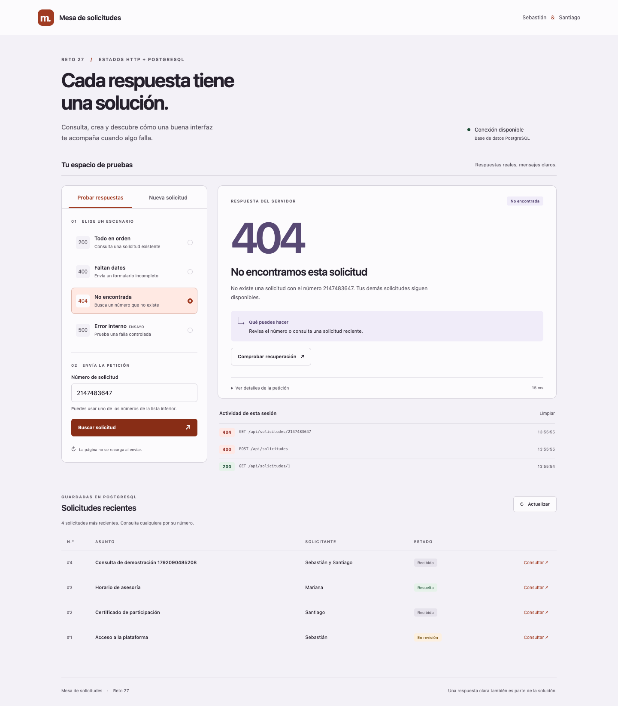
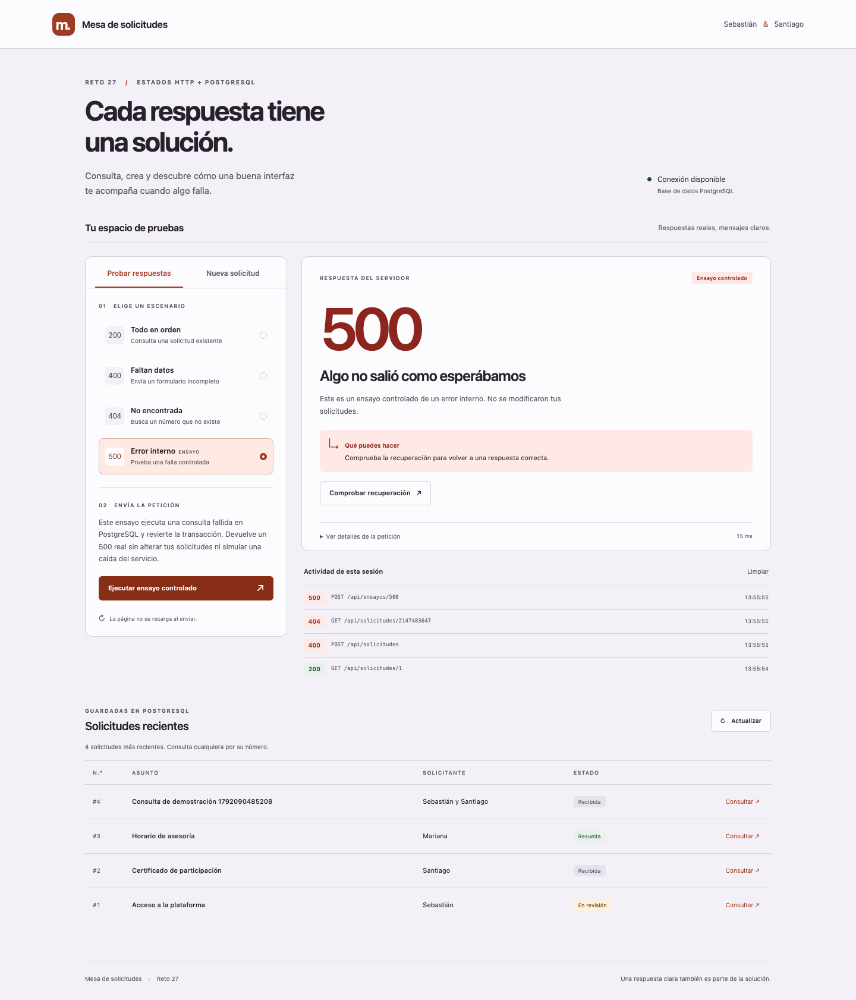
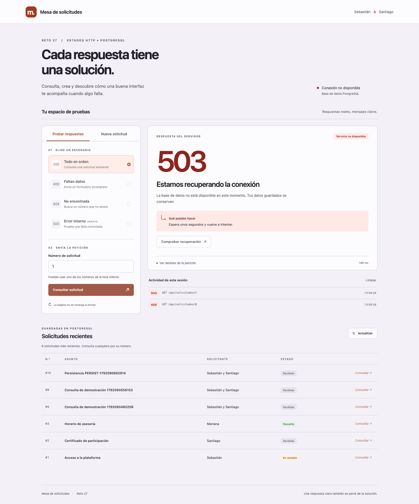
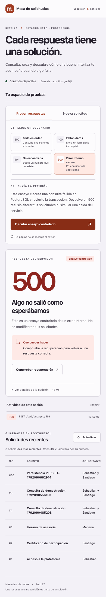

# Evidencias del reto 27

**Integrantes: Sebastián y Santiago.**  
Verificación realizada el **15 de octubre de 2026** con Docker, Node.js 22 y las bases de datos reales de la entrega.

## Pruebas reproducibles

```sh
docker compose up --build -d --wait
docker compose exec -T app npm run verificar
docker compose exec -T app npm test
```

Resultado: **14 pruebas aprobadas, 0 fallos, 0 omitidas**, más verificación de sintaxis correcta. La suite utiliza HTTP y PostgreSQL reales. [Salida completa](evidencias/pruebas.txt).

## Flujo de la interfaz

Se comprobaron respuestas 200, 201, 400, 404 y 500 desde el backend, sus mensajes y acciones, la recuperación posterior al ensayo 500, la validación por campo, la creación persistente y la actualización del listado sin recargar el documento. También se comprobó pérdida de red y recuperación con HTTP 200.

Las pestañas funcionan con teclado y la vista de 390 px no desborda el documento. La revisión automática de accesibilidad con reglas WCAG A y AA no registró incidencias en la pantalla revisada. [Registro de comprobación](evidencias/interfaz.txt).

## Persistencia e indisponibilidad real

Se creó una solicitud mediante HTTP, se eliminaron ambos contenedores con `docker compose down`, se recrearon conservando el volumen y se recuperó el mismo contenido con HTTP 200. [Registro de persistencia](evidencias/persistencia.txt).

También se detuvo realmente PostgreSQL con `docker compose stop db`. La API respondió 503 y la interfaz mostró una acción de recuperación. Tras iniciar PostgreSQL de nuevo, la misma página recuperó la consulta con HTTP 200. El campo de número vacío se comprobó con respuesta 400. [Registro de indisponibilidad](evidencias/indisponibilidad.txt).

## Capturas

### Consulta correcta, 200



### Validación, 400



### Recurso ausente, 404



### Ensayo de error interno, 500



### PostgreSQL detenido, 503



### Vista móvil


